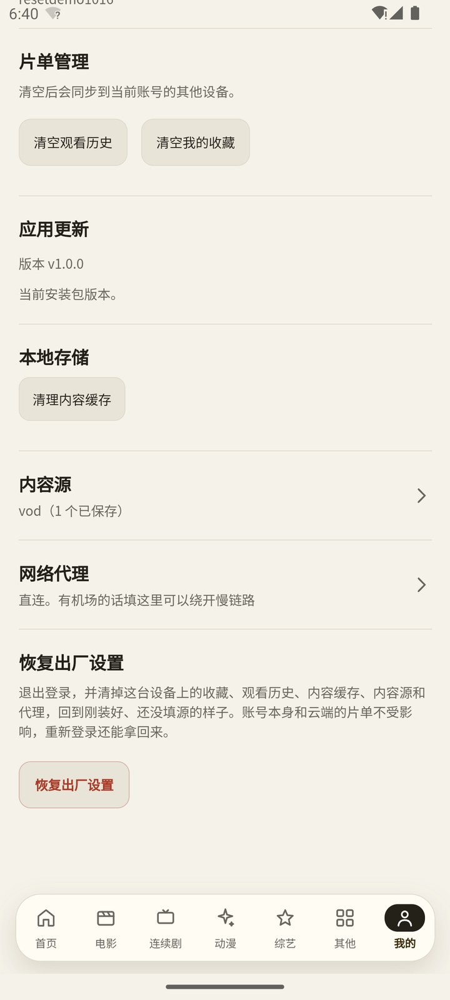
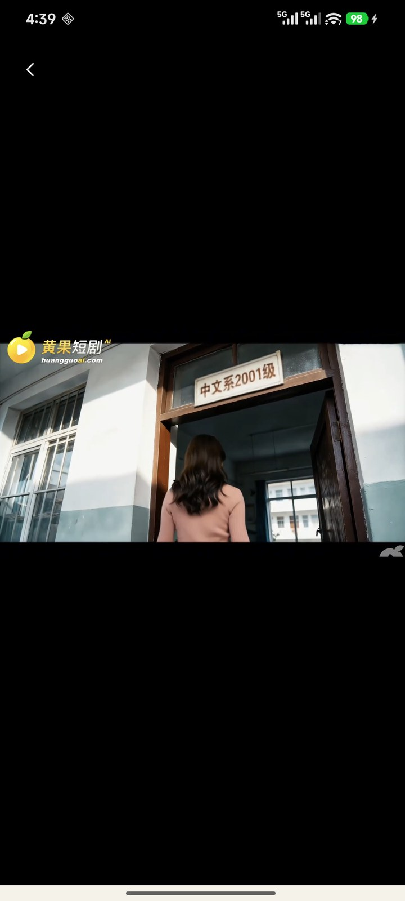
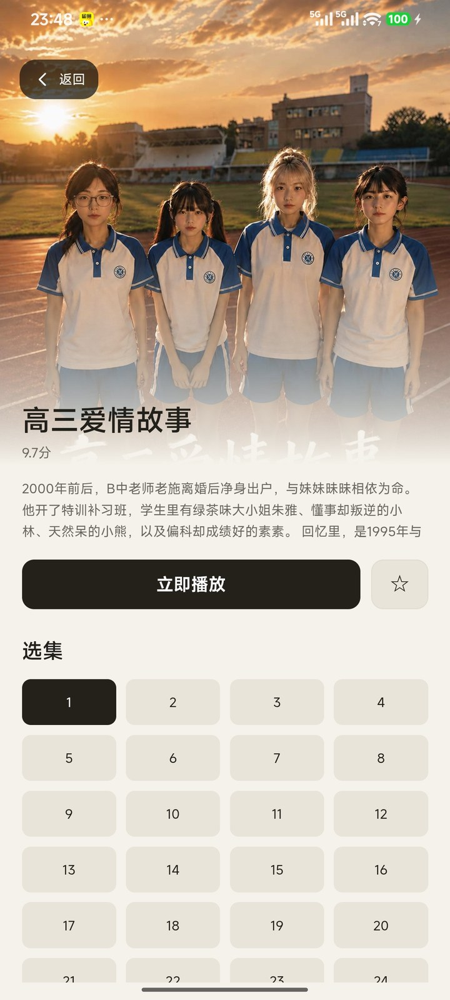
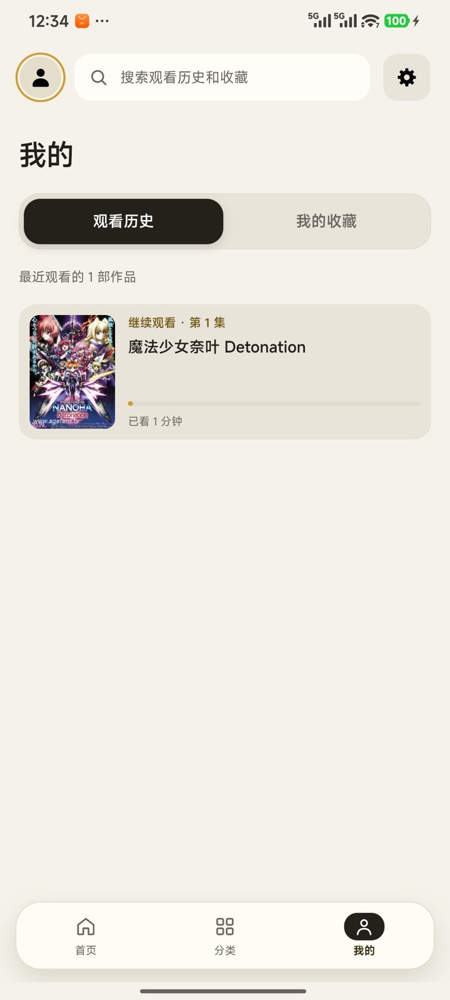

<p align="center"></p>

<h1 align="center">AIIvideo</h1>

<p align="center">
<a href="https://github.com/zhaoruizhe81/AIIvideo/releases/latest"></a>
<a href="https://github.com/zhaoruizhe81/AIIvideo/releases/latest"></a>
<a href="LICENSE"></a>
</p>

<p align="center"><b>一个安卓播放器壳。内容源由你决定。</b></p>

<p align="center">装完是空的 —— 不自带任何内容，第一次打开停在「设置源」。</p>

## 首页

轮播、分类胶囊、精选推荐，形状全部由源配置决定。换一个源就换一套界面，没有哪个入口是被硬留下来的。

<p align="center"></p>

## 自带内容源

填一个地址接入一个站点：自建接口、苹果CMS 采集站，或者按适配器接的站，自动识别。不想用了删掉即可，应用本身不站队。

<p align="center"></p>

## 竖屏播放流

上下滑切集，左右划拖进度（一屏宽约 120 秒，拖动中中央显示目标位置），两条轴不抢。横屏只旋转播放区，滚动容器不动；倍速、画面翻转、断点续播都在。

<p align="center"></p>

## 详情与选集

单集、多集、多线路都能画出来。点进详情直接起播，不用来回跳。

<p align="center"></p>

## 收藏与观看历史

存在本机，**不登录也能用**。想跨设备同步再登录 —— 账号只服务于这一件事。

<p align="center"></p>

## 安装

前往 [Releases](https://github.com/zhaoruizhe81/AIIvideo/releases/latest) 下载 APK（约 47 MB，Android 8.0 及以上）。装完填一个源配置地址就能用。

配置从哪来：自己写一份，或者用别人分享的。格式看 [站点配置参考](docs/站点配置参考.md) —— 完整字段表、响应形状、三道校验的报错对照，以及一份能直接抄的最小配置。

要自己写一个内容源（爬虫）见 [Spider 接入规范](docs/spider-接入规范.md) —— 配置字段、JS 侧的 `net`/`netAll` 契约、七个能力的返回形状、盾后站点怎么声明、90 秒预算和 4MB 上限这些硬约束，以及一份能跑的最小源和常见故障对照表。

设置里的「恢复出厂设置」会退出登录、清掉片单/缓存/内容源/代理，重启落回「设置源」那一屏。账号和云端片单不动，重新登录就回来。

> **仓库里不放 APK。** 二进制不进 git 历史（每发一版多 47 MB，删不掉），而且安装包里带着账号服务器的实际地址 —— 放 Releases 至少是个显式动作，不是「clone 一下就有了」。

## 许可与致谢

- 源码以 [GPL-3.0](LICENSE) 许可证开源。
- 应用外壳基于一个已有的安卓应用改造。早期以补丁集形式维护，2026-10-17 起是独立的 Gradle 源码工程。
- 「壳 + 自带源」这个交互范式来自 [TVBox](https://github.com/o0HalfLife0o/TVBoxOSC) 一系。

## 构建

源码在 [`work/android/`](work/android/)（Gradle 工程，不是 apktool 重打包）。

```bash
cd work/android
./scripts/build.sh verify    # 清空重建 + 242 个单测 + 断言 APK
./scripts/build.sh install   # 构建 → 装真机 → 冷启动 → 截图
```

需要 JDK 17 和 Android SDK 36。签名配置见
[`keystore.properties.example`](work/android/keystore.properties.example)（密钥不入库）。

架构说明、桥指令清单、测试与踩过的坑见 [`work/android/README.md`](work/android/README.md)；
业务与协议层面（账号后端、播放器、热更通道、发版流程）见 [开发说明](docs/开发说明.md)；
热更怎么发见 [热更新说明](docs/热更新说明.md)；
源市场清单是什么、为什么它不算一个源，见 [源市场清单](docs/2026-10-18-源市场清单.md)；
真机上接 Chrome DevTools 调页面（能直接调桥，不用重新打包）见
[真机 WebView 调试](docs/2026-10-18-真机WebView调试.md)。
