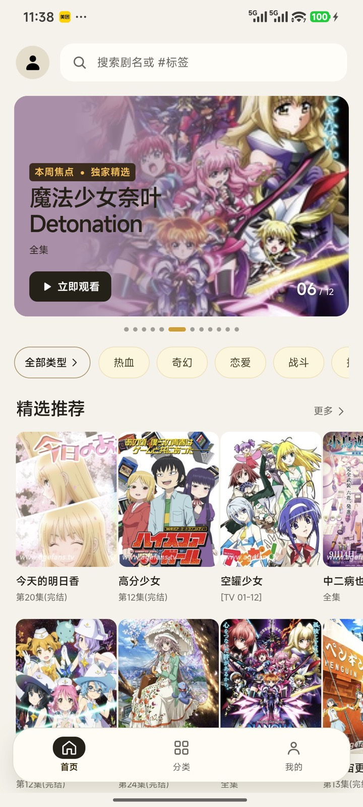
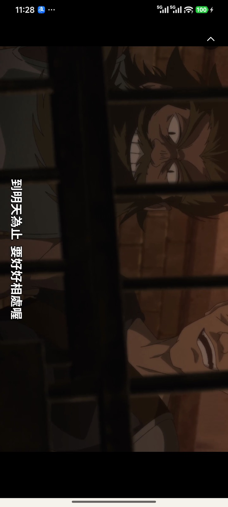
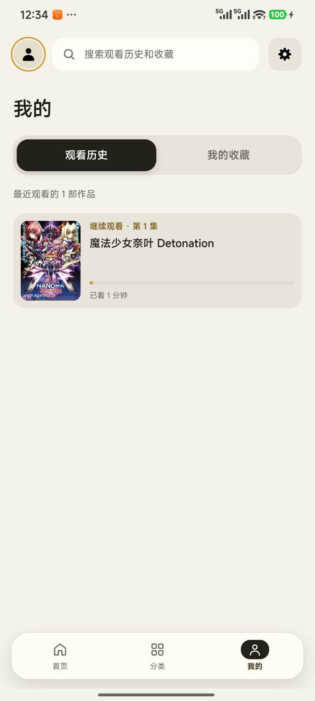

# AIIvideo

**一个安卓播放器壳。不带任何内容源。**

你给它一个源配置地址（一个 JSON），它把那个站接进来：首页、分类、搜索、详情、播放、
收藏、观看历史。首次启动会停在「设置源」——不自带任何内容，这是刻意的。

思路和 [TVBox](https://github.com/o0HalfLife0o/TVBoxOSC) 一系相同：**壳 + 用户自带源**。
区别在「源」长什么样 —— TVBox 下发的是可执行的 spider JAR，这里下发的是**声明式配置**，
只有声明表达不了的形状差异才落进内置适配器。

<p align="center">
  
  
  
</p>

## 它长什么样

- 竖屏沉浸式播放流。上下滑切集，左右划拖进度（一屏宽约 120 秒，拖动中中央显示目标位置），
  两条轴不抢
- **WebView 原生 HLS** —— 走系统播放器，媒体请求不带 `Origin`，CDN 才给正片。
  hls.js 那条路试过，它的 XHR 必带 `Origin`，某些 CDN 见之只返回一段宣传片
- 竖屏 / 横屏（横屏只旋转播放区，滚动容器不动），画面翻转，倍速
- 收藏和观看历史。登录后跨设备同步，**不登录也能用**（存在本地）
- 设置里可以**恢复出厂设置**：退出登录、清掉片单/缓存/内容源/代理，重启落回「设置源」
  那一屏。账号和云端片单不动，重新登录就回来

## 快速开始

去 [**Releases**](../../releases/latest) 下载 APK（约 7.7 MB，Android 8.0+），装完填一个
源配置地址就能用。

配置从哪来：看 [`docs/站点配置参考.md`](docs/站点配置参考.md) —— 完整的字段表、
接口响应形状、三道校验的报错对照，以及一份最小可用配置。

> **仓库里不存 APK。** 二进制不进 git 历史（每发一版多 8 MB，删不掉），
> 而且 APK 里烧着账号服务器的实际地址 —— 放 Releases 至少是个显式动作，
> 不是「clone 一下就有了」。要自己构建看[下面](#从源码构建)。

## 源是声明式的

一份配置描述一个站点：

```json
{
  "origin": "https://example.com",
  "web": {
    "paths": {
      "home": "/api/home",
      "category": "/api/videos?cate_id={cateId}&page={page}&size={size}",
      "detail": "/api/videos/{id}",
      "episode": "/api/videos/{id}/play?ep={episode}"
    },
    "categories": { "movie": 1, "tv": 2, "anime": 3 },
    "fields": {
      "title": ["title", "vod_name"],
      "cover": ["cover", "vod_pic"],
      "badge": ["badge", "vod_remarks"]
    },
    "shapes": {
      "home": { "featured": "recommend", "latest": "latest" },
      "list": { "items": "videos", "pages": { "div": ["total", "$pageSize"] } }
    },
    "ui": { "tabs": [{ "key": "movie", "label": "电影", "icon": "film" }] }
  }
}
```

三层表达力，从便宜到贵：

| 层 | 管什么 | 例子 |
|---|---|---|
| `fields` | 字段**叫什么** | `"title": ["title", "vod_name"]` —— 按顺序取第一个有值的 |
| `shapes` | 值**挂在哪根枝上** | `"featured": "recommend"`，支持带点路径 `video.name` |
| `adapter` | **结构重排** —— 到这里才写代码 | `cms` / `agedm` |

**分界线画在「声明 vs 计算」。** `fields` 和 `shapes` 的键名与值形态在构建期和保存前
都会校验 —— 因为它拼错了**不会报错，只会静默不生效**：配置看着是对的，界面永远是空的。
再往下（表达式、条件、遍历）就不是配置了，是一门没有工具链的语言，写错了只有
「某个字段是 undefined」，没有栈、没有断点。

`shapes` 里唯一允许的运算是 `{"div": ["total", "$pageSize"]}` —— 分页接口基本都只给
`total`，页码数得自己算。就这一个除法，不是表达式求值器的开头。

## 适配器按「族」摊销，不是按站

| 适配器 | 覆盖 | 为什么需要它 |
|---|---|---|
| `cms` | **苹果CMS 系全部站点** | 实测四家站（暴风 / 量子 / 非凡 / 无尽）：顶层键完全一致，条目字段交集 95 / 并集 95。同族内 100% 同构 |
| `agedm` | AGE动漫 | 卡在结构重排：它给的是 `playlists{源:[[集名,地址]]}`，我们要平的 `episodes[]` |

**加一个同族站，零代码。** 换字段名改 `fields`，换域名改 `paths`。
加一个**别的族**才要写适配器 —— 而新的那个同样按族摊。

判断一个站属于哪个族，看它的接口：`?ac=list` 回 `{code, class[], list[]}` 就是 `cms` 族。

## 账号后端

[`server/account/`](server/account/) —— PostgreSQL 16 + FastAPI，接口是 **Parse REST 的一个子集**。

登录只为了把收藏和观看历史跨设备同步。不登录完全能用。

```bash
cd server/account
cp .env.example .env      # 填 POSTGRES_PASSWORD
docker compose up -d --build
```

为什么是 Parse 协议而不是自己一套 REST：这个 APK 的壳里打包了完整的 Parse Android SDK，
沿用协议只需要改客户端一行地址。详见 [server/account/README.md](server/account/README.md)。

## 架构

```text
WebView（UI，见 work/shells/patches/assets/）
    │  bridgeCall(action, args)
    ▼
Java 数据层（OkHttp + DoH + SOCKS 代理）
    ├─ SiteRepository      解析 origin + paths
    ├─ AiiHttp             连接池 / 首屏预热 / 换源代次
    └─ CmsAdapter, AgedmAdapter      族适配器
    │
    ▼
站点接口
```

播放地址被加密时多一层，仍然不出进程：

```text
assets/hxm/  TinyGo wasm（站点自己的那个）
             ├─ md5.js        签名
             ├─ http.js       跨域请求走 HG_BRIDGE → Java 代发（站点不给 CORS 头）
             └─ agedm-play.js page → ?url= → AES-CBC 解 Data → hxm_decrypt → m3u8
```

前端只认一套**内部形状**（首页 `featured`/`latest`/`cate_rec`，列表 `items` + `pagination`，
详情 `episodes[]`），适配器负责把站点的形状翻译过来。所以加一个同族站不用动前端。

网络层几个不显然的点：

- **所有请求走 Java，不走 WebView 的 `fetch`** —— WebView 发请求会自动带
  `Origin: appassets.androidplatform.net`，实测这个头会让某些 CDN 连接超时
- **换源要作废旧请求**：`AiiHttp` 的预热/缓存是静态的，跨 `recreate()` 存活。
  换源时递增一个代次号，跑到一半的旧请求作废，否则新源首页会拿到上一个源的字节
- **首屏预热**：换源成功那一刻就去拉首页，等 WebView 起来时往往已经有结果了

## 从源码构建

```bash
cd work/shells
./build.sh fast      # 从工作树打包
./build.sh clean     # 从原始样本 + 补丁集重建（可复现路径）
./build.sh verify    # 逐文件比对，证明 patches/ 就是工作树的全部改动
./build.sh release   # 发版：刷补丁 → verify → 打包 → 报 sha256
```

依赖：apktool 3.x、Android SDK build-tools 34、JDK 17。

### 这是个重打包项目

APK 从一个**原始样本**解包改造而来，改动全部以补丁集的形式维护：

```text
原始样本 APK  +  work/shells/patches/（31 个文件，832 KB）  ≡  APK 工作树
```

`patches/` 里就是我们写的每一行：`assets/*.js`、`site-default.json`、
改过的 smali、`AndroidManifest.xml`。`clean` 和 `verify` 能**证明**这个等式成立。

**原始样本不随仓库分发** —— 它是别人的应用，提交上来等于二次分发。所以第一次构建
要你自己放一份到 `work/shells/chengzi-v0.3.15.apk`（`build.sh clean` 找不到会明确
告诉你路径）。没有样本也能用，只是只剩 `fast` 那条路 —— 需要一个已经存在的 APK
工作树，而它同样是推导出来的。

新增的 Java 代码在 [`work/shells/java-src/`](work/shells/java-src/)，
`build.sh` 会用 `javac` + `d8` 现编成 `classes5.dex` 塞进去，**不用重写 smali**。

### 出发布包

```bash
cd work/shells && ./build.sh release
cp cz-final.apk ../../AIIvideo-<版本>.apk
shasum -a 256 ../../AIIvideo-<版本>.apk        # 贴到 Release notes 里
```

**没有 CI，故意的。** 构建需要那个原始样本，而它不在仓库里 —— 押在 GitHub Actions 上
只会得到一个每次必红的 workflow。

## 文档

| 文档 | 内容 |
|---|---|
| [站点配置参考](docs/站点配置参考.md) | 配置文件的完整字段表、响应形状、三道校验、症状对照 |
| [AGE动漫 逆向](docs/2026-10-16-agedm-逆向.md) | 一个真实站点的完整接口图，以及它为什么需要适配器 |
| [AGE动漫 播放层逆向](docs/agedm-播放层逆向/协议.md) | 加密播放那一层的完整协议：wasm 怎么跑起来、签名怎么拼、Data 怎么解，附可复现 harness |
| [用户自带源与适配层](docs/2026-10-16-用户自带源与适配层.md) | 源识别、适配器分发、网络层、缓存，22 个坑 |
| [开发说明](docs/开发说明.md) | 目录结构、常用命令、真机调试 |

## 已知限制

- **播放地址加密的站，一个站一套做法，摊不开。** AGE动漫 的播放层是一个 Go/WASM 签名门
  （307 KB wasm + 每次请求都变的密文），这一版已经进去了：站点的 wasm 打进 APK
  （`assets/hxm/`），在 WebView 里当加解密器跑，签名、换会话、解 `Data`、`hxm_decrypt`
  全在本地完成，完整协议见 [播放层逆向](docs/agedm-播放层逆向/协议.md)。实测 5/5 线路可播。
  **但这是「一站一方」** —— 换一个同样加密的站得从头啃一遍，不像 `cms` 那样一个适配器
  摊销掉一整族。多线路切换还没做，只取第一条。
- **账号服务器地址写死在 APK 里。** 换服务器要发新版。用免费域名只是把「IP 变」换成
  「域名到期」，没有解决。
- 只测过 arm64 真机。

## 致谢

本项目的 APK 基于一个已有的安卓短剧应用重打包改造（原始样本 `chengzi-v0.3.15.apk`）——
没有它就谈不上这套壳和播放器。改造部分全部以补丁集形式维护。

「壳 + 自带源」这个交互范式来自 [TVBox](https://github.com/o0HalfLife0o/TVBoxOSC) 一系。

GPL-3.0。
